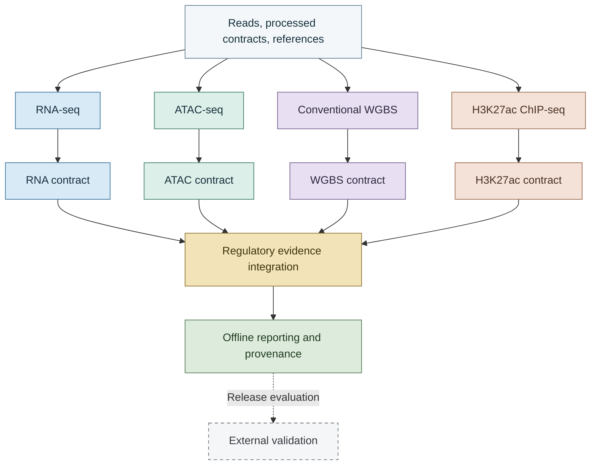
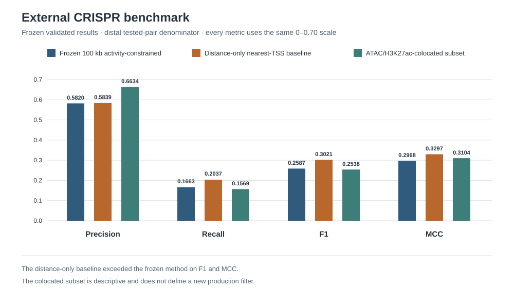
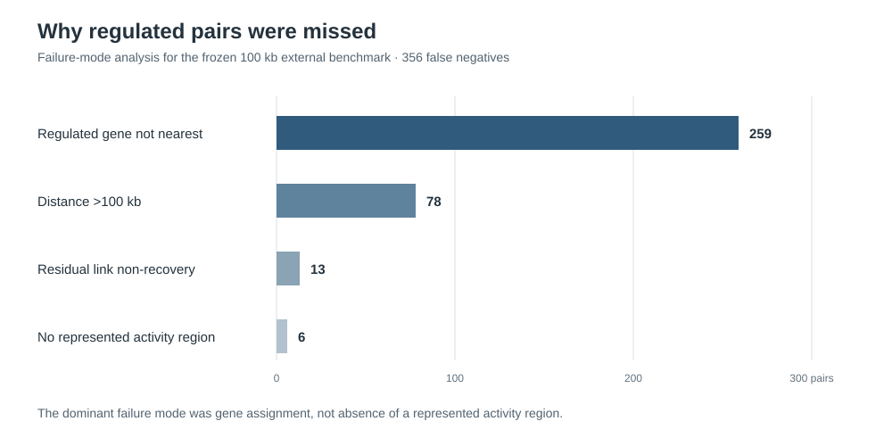
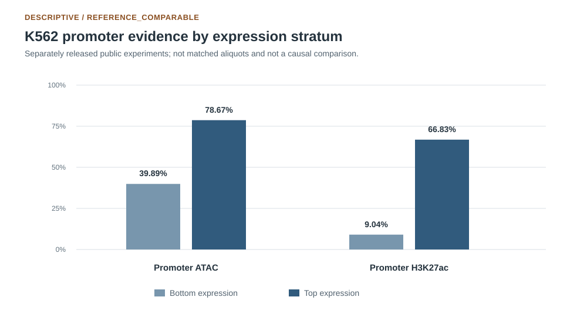

# Regulatory Multi-Omics Pipeline

[](https://doi.org/10.5281/zenodo.23397400)
[](https://github.com/sarvezh1/regulatory-multiomics-pipeline/releases/latest)
[](https://github.com/sarvezh1/regulatory-multiomics-pipeline/actions/workflows/ci.yml)
[](LICENSE)

[](https://www.nextflow.io/)
[](https://www.docker.com/)


## What this pipeline does

- Runs raw or quantitative processed-input routes for four human bulk assays on GRCh38.
- Preserves counts, technical-library structure, matched ChIP input controls, assay-specific inference, and explicit missingness.
- Integrates promoter evidence, ATAC/H3K27ac co-localization, and distal nearest-TSS candidate links.
- Produces component-scoped statuses, provenance manifests, validation artifacts, and an offline HTML report.

The workflow does not combine cross-assay p-values, create an opaque regulatory score, or label a nearest-TSS candidate as a validated target.

## Architecture



## Validation highlights

All values below are frozen validated results; bounded chromosome 22 executions are execution checks rather than genome-wide biological benchmarks.

| Area | Representative validated outcome |
|---|---|
| RNA | Bounded genuine execution: 5,358 unique chr22 alignments and 1,747 genes with counts. |
| ATAC | Two genuine untreated paired-end subsets completed; sparse chr22 peak calling returned a valid `COMPLETE_EMPTY_RESULT`. |
| WGBS | 5,721 canonical CpGs recovered; differential analysis was disabled for the genuine single-sample execution. |
| H3K27ac | Genuine treatment/input execution: 45 MACS3 peaks and 44 consensus regions. |
| Integration | 8,676 promoters, 1,747 genes, 1,050 ATAC/H3K27ac co-localizations, and 1,884 nearest-TSS distal candidates. These K562 inputs are `REFERENCE_COMPARABLE`, not sample matched. |
| External CRISPR benchmark | Frozen 100 kb activity-constrained method: precision 0.5820, recall 0.1663, F1 0.2587, MCC 0.2968. Distance-only nearest-TSS baseline: F1 0.3021, MCC 0.3297. |

The simple distance-only baseline outperformed the frozen activity-constrained method on F1 and MCC. Of 356 false negatives, 259 involved an experimentally regulated gene that was not the nearest gene. The CRISPR comparison is an external functional benchmark; the ATAC/H3K27ac-colocated subset shown below is descriptive and is not a new production filter.





The K562 plausibility check is descriptive and reference-comparable, not a matched-sample or causal analysis.



## Representative outputs

A completed run can produce:

- assay-specific QC summaries and standardized quantitative contracts;
- differential outputs when replication and design make inference statistically valid;
- promoter-linked regulatory evidence and ATAC/H3K27ac co-localization;
- distal nearest-TSS candidate links, explicitly labelled as predictive candidates;
- missingness-aware component statuses;
- checksummed provenance manifests; and
- a self-contained offline HTML report.

See the [output reference](docs/output_reference.md) for contract and table definitions.

## Quick start

Requirements are Nextflow `26.04.6`, Java 17, Docker capable of Linux/amd64 images, compatible FASTA/GTF references, and valid tab-separated inputs. Inspect the built-in parameter summary:

```bash
nextflow run main.nf --pipeline_help true
```

Run raw RNA-seq:

```bash
nextflow run main.nf -profile docker \
  --assay RNA \
  --input rna_samplesheet.tsv \
  --fasta GRCh38.primary_assembly.fa \
  --gtf gencode.v50.annotation.gtf
```

Run baseline integration from standardized contracts:

```bash
nextflow run main.nf -profile docker \
  --assay INTEGRATION \
  --integration_manifest integration_manifest.tsv \
  --fasta GRCh38.primary_assembly.fa \
  --gtf gencode.v50.annotation.gtf \
  --integration_mode baseline \
  --integration_match_type REFERENCE_COMPARABLE
```

Differential analyses are opt-in and require an explicit design and contrast. More runnable routes are in the [usage guide](docs/usage.md).

## Inputs and outputs

RNA accepts single- or paired-end reads; ATAC and conventional WGBS accept paired-end reads; H3K27ac accepts validated single- or paired-end reads with an explicit matched input control. Each assay also supports a quantitative processed-input route. Samplesheet fields are defined in [schemas/samplesheet_columns.tsv](schemas/samplesheet_columns.tsv).

Assay branches emit standardized contracts, QC tables, statuses, and provenance. Integration emits promoter and distal relationship tables, gene summaries, sensitivity results, and missingness-aware statuses; reporting adds manifest sets and the offline report.

## Reproducibility and limitations

Deterministic fixtures cover raw and processed routes, statistical guards, reporting, and integration edge cases. Docker Linux/amd64 is the only empirically validated backend; other schedulers, architectures, operating systems, and container backends are not claimed as validated.

Association and concordance are not causality. Nearest-TSS links are predictive candidates only; cCRE analysis is annotation concordance, not independent validation; and the CRISPR comparison is an external functional benchmark among experimentally tested pairs. The K562 integrations are `REFERENCE_COMPARABLE`, not matched aliquots. Descriptive WGBS methylation results do not establish a clean inverse promoter methylation/expression relationship. No ABC or Hi-C computation was performed.

Scientific tables and deterministic identifiers are compared by normalized content; logs, HTML, compressed files, and runtime metadata may vary at the byte level. See [reproducibility](docs/reproducibility.md), [reporting](docs/reporting.md), and [external validation methods](docs/external_validation.md).

## Documentation

- Assays: [RNA validation](docs/validation/rna.md), [ATAC validation](docs/validation/atac.md), [WGBS validation](docs/validation/wgbs.md), and [H3K27ac validation](docs/validation/h3k27ac.md)
- Integration and release evidence: [integration validation](docs/validation/integration.md), [reproducibility validation](docs/validation/reproducibility.md), and [external validation](docs/validation/external.md)
- Guides: [usage](docs/usage.md), [output reference](docs/output_reference.md), [public data sources](docs/public_data_sources.md), and [documentation map](docs/documentation_map.md)

## Citation and license

Version `0.1.0` is archived on Zenodo with DOI
[`10.5281/zenodo.23397400`](https://doi.org/10.5281/zenodo.23397400).

Citation metadata are provided in [`CITATION.cff`](CITATION.cff). GitHub can also generate APA and BibTeX citations from this file.

Project-authored code and documentation are available under the [MIT License](LICENSE). Third-party data and resources retain their original terms and are not relicensed by this project.
